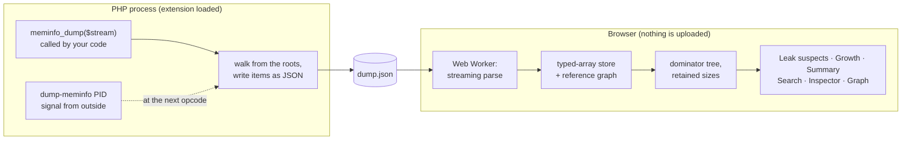
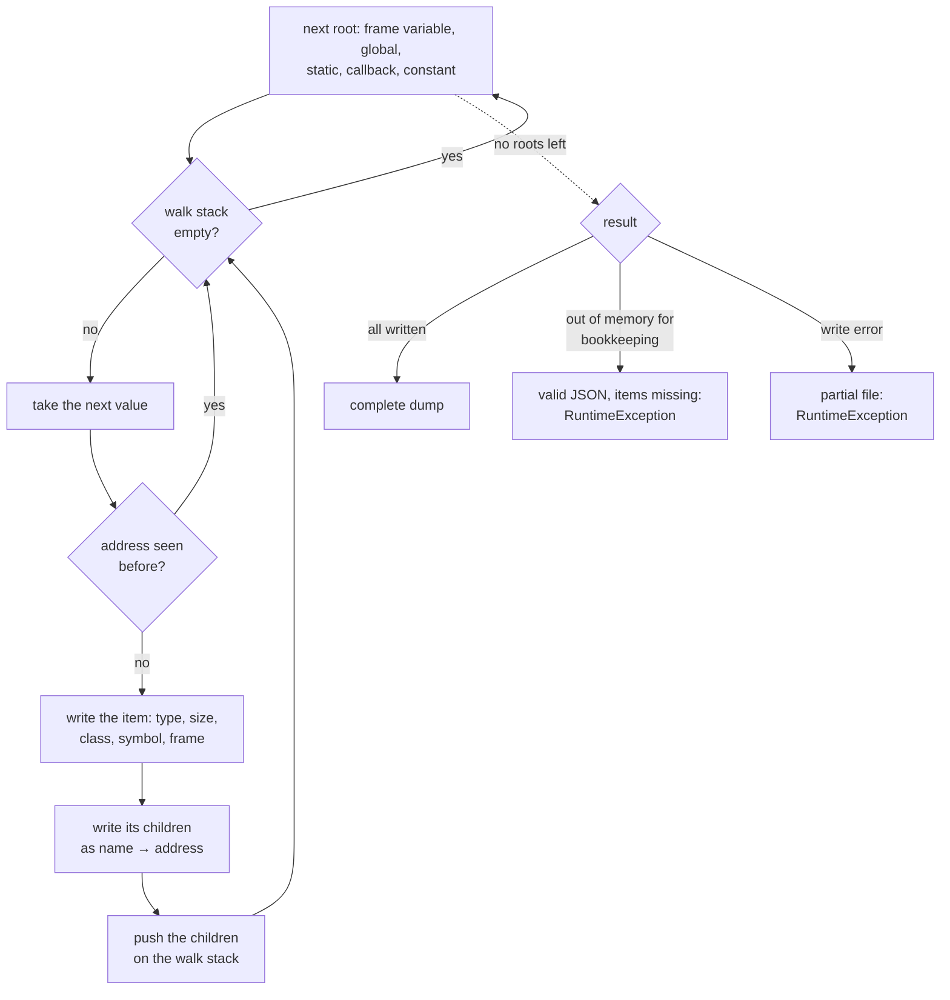
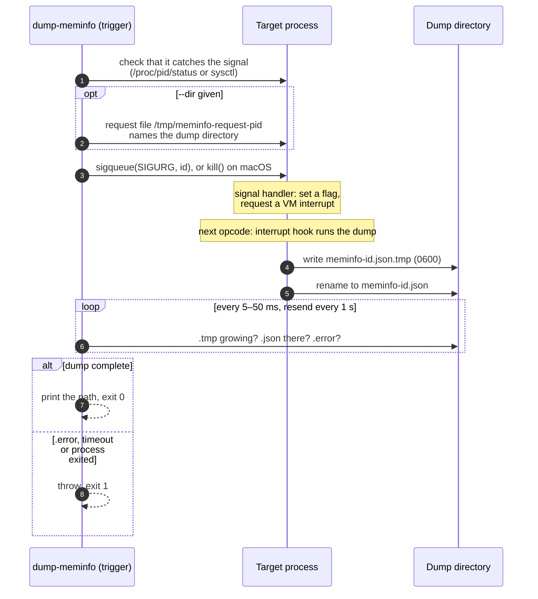

MEMINFO
=======


PHP Meminfo is a PHP extension that writes the content of PHP memory to a JSON file: every array,
object and value still reachable, the variable or static it hangs from, and what refers to what. Its
main goal is to help you find memory leaks in long-running PHP processes. The dump is analyzed in a
[browser UI](https://vantafinance.github.io/php-meminfo/) that runs entirely in your browser and
points at what keeps memory alive and what grows. A process can be dumped from its own code with
`meminfo_dump()`, or from outside, while it runs, with `dump-meminfo <pid>`.

One of the main sources of inspiration for this tool is the Java jmap tool with the `-histo` option.

Compatibility
-------------

Minimum supported version: **PHP 7.0**. Supported: PHP 7.0 – 8.5 (tested in CI on every version).
Dumping another, running process needs the target to be PHP 7.1 or later, non-ZTS, on POSIX.

Installation
------------

Two packages:

| Package | What | Installed with |
|---|---|---|
| `vanta/meminfo` | the extension: `meminfo_dump()`, `meminfo_dump_process()` | [PIE](https://github.com/php/pie) |
| `vanta/dump-meminfo` | the `dump-meminfo <pid>` command | Composer |

### With PIE (recommended)

[PIE](https://github.com/php/pie) is the official installer for PHP extensions, the successor of
PECL. It builds the extension for your PHP, installs it and enables it in the right ini file
(`phpenmod`, `docker-php-ext-enable`, the scan directory or `php.ini`).

Install PIE once (it needs PHP 8.1+ to run, but installs into any PHP version):

```bash
$ curl -fL --output /tmp/pie.phar https://github.com/php/pie/releases/latest/download/pie.phar \
    && gh attestation verify --owner php /tmp/pie.phar \
    && sudo mv /tmp/pie.phar /usr/local/bin/pie \
    && sudo chmod +x /usr/local/bin/pie
```

Then install the extension and check that it is loaded:

```bash
$ pie install vanta/meminfo
$ php --ri meminfo
```

| Need | Command |
|---|---|
| A specific version | `pie install vanta/meminfo:^0.1` |
| Another PHP installation (e.g. PHP 7.4 next to 8.4) | `pie install --with-php-config=/usr/bin/php-config7.4 vanta/meminfo` |
| A custom reported version or copyright year | `pie install vanta/meminfo --with-meminfo-version=0.1.0-custom --with-meminfo-copyright-year=2026` |
| Install without touching ini files | `pie install --skip-enable-extension vanta/meminfo`, then [enable it](#enabling-the-extension) yourself |

PIE writes into the system extension and ini directories, so it may ask for your password. In CI or
another non-interactive shell, run it as root: it does not call `sudo` itself without a terminal.
Windows is not supported. NTS and ZTS builds both work, but only NTS can be
[dumped from outside](#dumping-a-running-process).

> [!NOTE]
> Until `vanta/meminfo` is published on Packagist, install it from a checkout of this repository.
> This is what CI does:
>
> ```bash
> $ pie repository:add path /path/to/php-meminfo
> $ pie install 'vanta/meminfo:*@dev'
> ```

### The `dump-meminfo` command

```bash
$ composer require --dev vanta/dump-meminfo
$ vendor/bin/dump-meminfo <pid>
```

It is a thin wrapper over `meminfo_dump_process()`, so the extension has to be loaded for the PHP
that runs it, as well as in the process it dumps. `make install-cli` installs it from a checkout
instead (see below).

### Docker

With PIE, in your own image. PIE is mounted only while the layer builds and does not stay in the
image. It needs `unzip` or ext-zip:

```dockerfile
FROM php:8.4-cli

RUN --mount=type=bind,from=ghcr.io/php/pie:bin,source=/pie,target=/usr/local/bin/pie \
    set -eux; \
    apt-get update; \
    apt-get install -y --no-install-recommends unzip; \
    pie install --no-cache vanta/meminfo; \
    apt-get purge -y --auto-remove unzip; \
    rm -rf /var/lib/apt/lists/*
```

`make docker-build PHP_VERSION=8.1` builds a ready image (`meminfo:php-8.1`) from the repository
`Dockerfile`; see [Development](doc/development.md) for the Docker test matrix and the IDE setup.

### From source

A `Makefile` in the repository root wraps the build. Run `make help` to list every target.

```bash
$ make build          # build the extension (phpize + configure + make, as needed)
$ make install-ext    # install it into the PHP extension directory (may need sudo)
$ make install-cli    # install the dump-meminfo command into $(PREFIX)/bin, default /usr/local
$ make test           # run the extension's .phpt suite
```

To build against a specific PHP installation, override the toolchain variables:

```bash
$ make build PHPIZE=/usr/local/php-7.4/bin/phpize PHP_CONFIG=/usr/local/php-7.4/bin/php-config
```

The reported version and copyright year are build arguments (`make build MEMINFO_VERSION=2.1.0`); see
[Development](doc/development.md#version-and-copyright-year).

Without Make, from the `extension` directory:

```bash
$ phpize
$ ./configure --enable-meminfo
$ make
$ make install
```

### Enabling the extension

PIE does this for you. After a build from source (or `--skip-enable-extension`), add the following
line to your `php.ini`:

```ini
extension=meminfo.so
```

### Settings

Both settings are `PHP_INI_SYSTEM` and only matter for [dumping a running process](#dumping-a-running-process):

| Setting | Default | Meaning |
|---|---|---|
| `meminfo.dump_signal` | `SIGURG` | Signal the process dumps on, by name or number. `0` or empty disables it. |
| `meminfo.dump_dir` | system temp dir | Where dumps are written unless the trigger passes `--dir`. |

`php -i | grep meminfo` shows what a build resolved. Details, and why `SIGURG`, are in
[Dumping a running process](doc/process_dump.md#settings).

Usage
-----

### Dumping memory content

```php
meminfo_dump(fopen('/tmp/my_dump_file.json', 'w'));
```

This writes a dump of the PHP memory, as JSON, to the given stream: a file, or `php://stdout`. It
throws `RuntimeException` when the stream cannot be written to, or when the dump is incomplete. [`doc/example.php`](doc/example.php)
is a minimal script (`make dump-example` runs it).

### Dumping a running process

When a worker is already running and leaking, ask it for a dump from outside, without changing or
restarting it. The target only needs the extension loaded; it writes the dump at the next safe point
between two opcodes, and the command prints its path:

```bash
$ dump-meminfo <pid> [--dir=DIR] [--signal=SIG] [--timeout=SEC] [--force]
$ dump-meminfo 12345 --dir=/tmp
/tmp/meminfo-1834201933.json
```

The same from PHP: `$path = meminfo_dump_process(12345, ['dir' => '/tmp']);`. Every failure throws;
the command exits with 1 on a runtime failure and 2 on bad usage. Under php-fpm, only a worker that is
serving a request can be dumped — take its pid from the status page, never the master's.

Errors, settings, FPM, containers, security and limitations are covered in
[Dumping a running process](doc/process_dump.md).

### Analyzing a dump in the browser

Open <https://vantafinance.github.io/php-meminfo/> and drop the dump on the page. The page is static:
the dump is read and analyzed in your browser and never leaves it. To run it locally (Node 24+):

```bash
$ make ui-install
$ make ui-dev         # then open the printed URL
```

It shows the leak suspects (what retains the most memory), growth against an earlier dump of the same
process, a summary by type and class, the largest collections, a search, and for any item every
reference path from a root and a graph of what keeps it reachable. See `ui/README.md` for building
and testing it.

[Hunting down memory leaks](doc/hunting_down_memory_leaks.md) walks through a real investigation with
it, step by step.

How it works
------------

### Overview

The extension writes a snapshot of everything the program can still reach as one JSON file. The UI
turns that file into a graph and asks which items keep the most memory alive.



### What a dump contains

The walk starts from every root, in this order, and follows every reference it finds:

1. the execution frames of the current call stack, then the frames of suspended Fibers (PHP 8.1+);
2. the global variables;
3. static properties of classes;
4. `static` variables of functions and methods;
5. registered callbacks: error and exception handlers, shutdown functions, output buffer handlers;
6. user constants that hold arrays or objects.

Each value reached is written once, as an item keyed by its address. Objects are keyed by the
object, so many variables pointing at one object give one item. An item lists its children by name
and address before they are visited. The walk uses its own stack instead of C recursion, so deep
structures cannot overflow it. Reading an object never calls PHP code (`__get`, `__debugInfo`) and
never builds a property table that the object did not have.



The writer allocates its buffer outside PHP's memory manager, so a dump does not count against
`memory_limit`. A regular file is written directly. Other streams (sockets, pipes, filtered or
userspace streams) are spooled to a temporary file first and copied once the walk is over, so no
PHP code runs in the middle of it. The `size` of an item is an estimate of the value's own
structure: the zval plus a string's bytes, an array's hash table or an object.

### How a running process is dumped

Code cannot run safely inside a signal handler, so the handler only leaves a flag. The dump is
written at the next point where the Zend VM checks for interrupts, which is between two opcodes.
The file appears under its final name only once it is complete.



While it dumps, the target pauses the `max_execution_time` timer and lifts `memory_limit`, then
restores both. Nothing is written to its output. A process blocked in an idle event loop runs no
opcode and so cannot answer until it wakes up. Settings, security checks, FPM and containers are in
[Dumping a running process](doc/process_dump.md).

### The dump format

```json
{
  "header": {"memory_usage": 2097152, "memory_usage_real": 2097152, "peak_memory_usage": 2097152, "peak_memory_usage_real": 2097152},
  "items": {
    "0x7f2a4c05e0c0": {"type": "array", "size": "128", "symbol_name": "users", "is_root": true, "frame": "<GLOBAL>",
                       "children": {"0": "0x7f2a4c062a00"}},
    "0x7f2a4c062a00": {"type": "object", "size": "72", "is_root": false, "class": "User", "object_handle": "3",
                       "children": {"name": "0x7f2a4c062a28"}}
  }
}
```

- `items` is keyed by address. Addresses only identify an item within one dump.
- `children` maps a property name or array key to the address of another item. The graph follows
  these edges.
- `is_root` items carry `symbol_name` and `frame`: the variable name and where it lives (`func()`,
  `Class->method()`, `<GLOBAL>`, `<CLASS_STATIC_MEMBER>`, `<STATIC_VARIABLE>`, `<CALLBACK>`,
  `<CONSTANT>`).

### Analysis in the browser

The UI reads the file as a stream in a Web Worker, without ever holding the whole text. It stores
the items in typed-array columns, with the references as a compact edge list. From a virtual root
pointing at every `is_root` item, it computes the dominator tree. An item's **retained size** is
everything that would be freed if that item went away. **Leak suspects** are the items and classes
that retain the most. **Growth** compares the counts and sizes per type and class against an
earlier dump of the same process. The page only receives the rows and subgraphs it displays. It
sends nothing anywhere, and its Content Security Policy only allows connections to the page's own
origin, so the dump never leaves your machine.

Other memory debugging tools for PHP
------------------------------------

- [Xdebug](https://xdebug.org/): its trace feature with memory deltas shows memory usage per function.
- [PHP Memprof](https://github.com/arnaud-lb/php-memory-profiler): aggregated memory usage by
  function, far less resource intensive than a full Xdebug trace.

FAQ
---

### `memory_usage` is much higher than what the dump accounts for

A lot of memory is used by the Zend Engine itself (compiled code, the virtual machine, the garbage
collector) and by extensions. PDO and mysqli, for example, buffer whole result sets in PHP memory by
default ([buffering](https://www.php.net/manual/en/mysqlinfo.concepts.buffering.php)), and image
extensions hold large buffers. All of it goes through the Zend Memory Manager, so it counts towards
`memory_get_usage()` and `memory_limit`, but meminfo only sees the data structures of your program,
not the extensions' own memory. Hence the gap, which can be large.

### "Call to undefined function" when calling `meminfo_dump`

The extension is not enabled. Look for the meminfo section in `php -i` (or a `phpinfo()` page) and
check the `extension=meminfo.so` line of the `php.ini` that PHP actually loads (`php --ini`).

### Why are most tests "skipped"?

The tests need JSON support, but `make test` runs them in a clean environment that loads no shared
extensions. If JSON is built as a separate extension (common before PHP 8), they are skipped. Run them
with your own configuration from the `extension` directory:

```bash
$ TEST_PHP_EXECUTABLE=$(which php) $(which php) run-tests.php -d extension=$PWD/modules/meminfo.so
```

More on building and testing in [Development](doc/development.md).

Credits
-------

Thanks to Derick Rethans for his inspirational work on the essential Xdebug. See https://xdebug.org/
